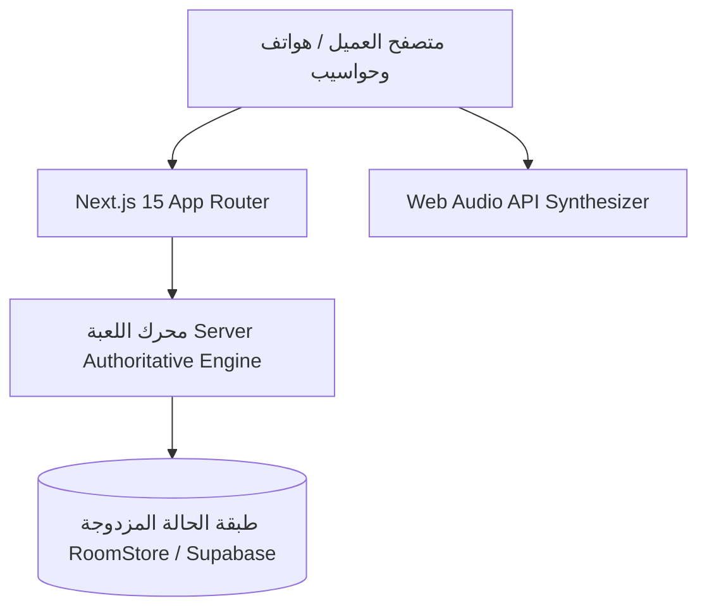
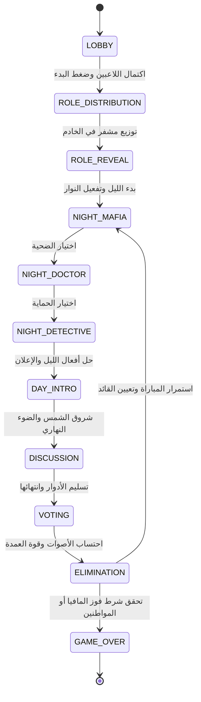

# بنية ومعمارية نظام Mafia Arena
## System Architecture & Technical Specifications

---

## 1. المعمارية العامة (Architecture Overview)

يعتمد مشروع **Mafia Arena** على نمط **Server-Authoritative State Machine** مع واجهات عميل تفاعلية بالكامل مبنية بتقنيات الويب الحديثة.

---

## 2. آلة حالات المباراة (State Machine Phases)

---

## 3. مبادئ الأمان والسرية (Security Model)

1. **حماية بطاقة الدور السري:**
   لا يتم بث جدول الأدوار الكامل لأي جهاز عادي عبر الـ Network payloads. يستعلم كل لاعب بطاقته الفردية فقط عبر `/api/game/role` مع التحقق من صحة `guestToken`.
2. **صلاحية القائد (Game Master):**
   عند إقصاء أول لاعب، يُسجل في الخادم كـ `leader_player_id`. الخادم هو من يقرر إرسال قائمة هويات اللاعبين في استعلام الدور للقائد فقط.
3. **منع التكرار (Idempotency):**
   كل فعل ليلي أو تصويت يتم قفله بمفتاح فريد يمنع تكراره في نفس الجولة.
