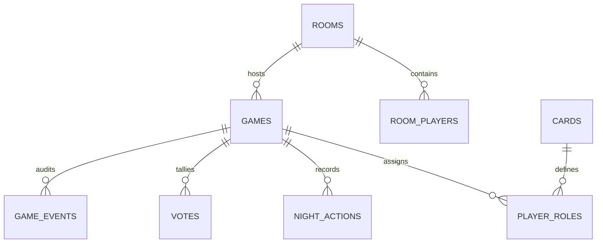

# توثيق قاعدة البيانات وسياسات RLS — Mafia Arena
## Database Schema & Row-Level Security

---

## 1. هيكل الجداول والعلاقات

### وصف الجداول الرئيسية:
1. `rooms`: تخزين الغرف المفتوحة والرموز الفريدة وإعدادات المباراة.
2. `room_players`: معلومات اللاعبين في الغرفة، الجلسات، المقاعد، وحالة البقاء على قيد الحياة.
3. `games`: حالة المباراة الجارية، رقم الجولة، المرحلة الحالية، ورقم إصدار المرحلة لمنع تضارب التحديثات.
4. `cards`: كتالوج الشخصيات والبطاقات ومسارات الصور والقدرات والقواعد الخاصة.
5. `player_roles`: جدول سري محمي يربط كل لاعب ببطاقته.
6. `night_actions`: سجل الأفعال الليلية المشفرة (اغتيال، حماية، تحري، قنص، تسكيت).
7. `votes`: سجل الاقتراع النهاري مع حفظ وزن الصوت (مثلاً: صوت العمدة = 3).
8. `game_events`: السجل العام للأحداث وإعلانات الصباح والمساء.
